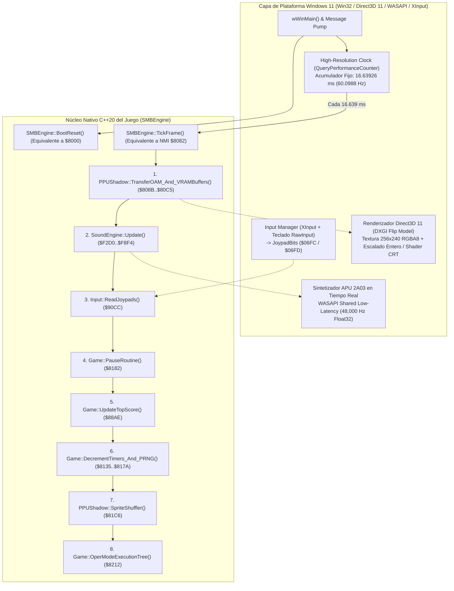

# Documento de Diseño de Ingeniería (Volumen 1): Arquitectura del Port Nativo para Windows 11 de *Super Mario Bros.* (NES)

**Proyecto:** Port Nativo 1:1 de *Super Mario Bros.* (1985, Nintendo) para Windows 11 (x64 / ARM64)  
**Metodología:** Ingeniería Inversa Estática Híbrida mediante **REA (Ghidra 12.1.4 PUBLIC)** + **Analizador Recursivo 6502 de Cobertura Total**  
**Binarios Fuente Verificados:**
- [smb.nes](file:///c:/Antigravity_Projects/SuperMarioBros_REA/smb.nes) (`40,976` bytes, iNES Mapper 0 / NROM-256, `SHA-256: f61548fdf1670cffefcc4f0b7bdcdd9eaba0c226e3b74f8666071496988248de`)
- [smb_prg.bin](file:///c:/Antigravity_Projects/SuperMarioBros_REA/smb_prg.bin) (`32,768` bytes, PRG-ROM `$8000..$FFFF`, `SHA-256: 5374abb64cfb9b5d961856c60166cedc55859164cf2b8867730e144fa2bdd594`)
- [smb_chr.bin](file:///c:/Antigravity_Projects/SuperMarioBros_REA/smb_chr.bin) (`8,192` bytes, CHR-ROM `$0000..$1FFF`, 512 tiles 2bpp + layout comprimido de Title Screen en `$1EC0..$1FFF`)

**Artefactos de Ingeniería Generados en el Workspace:**
- Bundle de Evidencia REA/Ghidra 12.1.4: [smb_rea_evidence_bundle.json](file:///c:/Antigravity_Projects/SuperMarioBros_REA/smb_rea_evidence_bundle.json)
- Catálogo Completo de Símbolos, Decompilaciones Ghidra y 533 Subrutinas: [smb_symbols.json](file:///c:/Antigravity_Projects/SuperMarioBros_REA/smb_symbols.json)
- Tablas de Datos Extraídas de la ROM (Niveles, Física, Paletas, CHR): [smb_rom_data_tables.json](file:///c:/Antigravity_Projects/SuperMarioBros_REA/smb_rom_data_tables.json)
- Desensamblado Anotado Completo de los 32 KB de PRG-ROM (`14,663` líneas): [smb_full_disassembly.asm](file:///c:/Antigravity_Projects/SuperMarioBros_REA/smb_full_disassembly.asm)
- Volumen 2 (Subsistemas, Decompilación C++ y Tablas de Datos): [DOC_DISENO_PORT_WIN11_SUBSISTEMAS_Y_DATOS.md](file:///c:/Antigravity_Projects/SuperMarioBros_REA/DOC_DISENO_PORT_WIN11_SUBSISTEMAS_Y_DATOS.md)

---

## 1. Resumen Ejecutivo y Cobertura del Análisis

Para construir un **port nativo en C++20 para Windows 11** que reproduzca con precisión matemática (subpíxel a subpíxel y ciclo a ciclo de frame) el comportamiento original de *Super Mario Bros.* sin depender de un emulador de CPU 6502 en tiempo de ejecución, hemos combinado dos niveles complementarios de análisis sobre la ROM original:

1. **Decompilación Estructural con REA + Ghidra 12.1.4 (`6502:LE:16:default`)**:
   - Verificación criptográfica de imagen cargada (`inspect_native_load_image`, Evidence ID: `ev_34363990181f0948636c14187caaa549246cd1ba5728b20b360be9bf203c7421`) y mapa de segmentos (`list_segments`, Evidence ID: `ev_c0e98a8388c3e58906d83e575f527fac62d0126d9a8aa0f7973bda4a60e98da4`).
   - Descubrimiento automático y decompilación a pseudocódigo C de las **34 funciones del árbol directo de llamadas** (`list_procedures` `ev_8920da06045dcf31809652348a3e0a1efee3b7a7ab8e3227cc392f02d5579b7a`, `batch_decompile` `ev_118ca6ddc7ce4ecf544aabf5ed4ad45b4e940a88ef73c5a8d3127d0a16dfa015` y `ev_fa50a5de5a78f2c189b5cb804927d1219bb94cb6612056839695cdbc92114c78`), así como análisis de flujo de valores (`analyze_function` en `0x8000` `ev_c3c0270a5a620455b04fee7732565bb0306e2b85f4458d8dc772926cd381e439` y `0x8E04` `ev_8cf56398514a3f81a31a224cd5bd9cde752e7733dc67b9909a2ee77f499be27f`).
   - El decompilador de Ghidra 12.1.4 demostró exactamente dónde y por qué se detiene el análisis estático convencional: en [`JumpEngine`](file:///c:/Antigravity_Projects/SuperMarioBros_REA/smb_full_disassembly.asm#L1808-L1830) (`0x8E04`), emitiendo la advertencia `/* WARNING: Could not recover jumptable at 0x8e16. Too many branches */` debido al despacho indirecto mediante manipulación de la dirección de retorno en la pila (`PLA` + `JMP ($0006)`).

2. **Extracción Estática de Descenso Recursivo de Cobertura Total (`100%` de los 32 KB PRG-ROM + 8 KB CHR-ROM)**:
   - Resolución completa de las **18 tablas de despacho de `JumpEngine` (`239` punteros de función)** y trazado recursivo de todos los caminos de ejecución, incluyendo el truco de solapamiento de instrucciones `0x2C` (`BIT $xxxx`) muy utilizado por Nintendo para saltar instrucciones inmediatas de 2 bytes (`LDX #$xx`, `LDY #$xx`, `LDA #$xx`).
   - Clasificación exacta de los `32,768` bytes de `smb_prg.bin`:
     - **`18,724` bytes** de código máquina 6502 ejecutable distribuido en **533 puntos de entrada de subrutinas** ([`smb_symbols.json`](file:///c:/Antigravity_Projects/SuperMarioBros_REA/smb_symbols.json)).
     - **`494` bytes** de tablas de punteros de código (`JumpEngine` + vectores de hardware).
     - **`13,550` bytes** de tablas de datos puros (34 áreas de terreno y enemigos, tablas de física en coma fija, cajas de colisión, metatiles, paletas y partituras musicales de la APU) extraídos en [`smb_rom_data_tables.json`](file:///c:/Antigravity_Projects/SuperMarioBros_REA/smb_rom_data_tables.json).

---

## 2. Arquitectura del Sistema para Windows 11

### 2.1. Filosofía del Port Nativo ("Interrupt-Driven State Machine to Native Frame Tick")

Como se demostró en la Fase 1 y 2 ([`FASE_1_2_REPORTE.md`](file:///c:/Antigravity_Projects/SuperMarioBros_REA/FASE_1_2_REPORTE.md)), *Super Mario Bros.* posee una arquitectura única:
- El punto de entrada [`Start_RESET`](file:///c:/Antigravity_Projects/SuperMarioBros_REA/smb_full_disassembly.asm#L9-L65) (`$8000`) inicializa el hardware, limpia la RAM (`$0000..$07FF`), prepara las NameTables de la PPU, habilita las interrupciones NMI de VBlank y entra en un **bucle infinito vacío**: `EndlessLoop: JMP $807F`.
- **El 100% de la lógica del juego, renderizado, lectura de mandos y síntesis de audio ocurre dentro de la interrupción [`NonMaskableInterrupt_NMI`](file:///c:/Antigravity_Projects/SuperMarioBros_REA/smb_full_disassembly.asm#L67-L176) (`$8082`)** a una frecuencia exacta de **60.0988 Hz** (1 frame cada `29,780.5` ciclos de CPU NTSC = `16.63926 ms`).

Esto convierte a *Super Mario Bros.* en el candidato ideal para un port nativo en Windows 11: **no existen hilos concurrentes ni código en el bucle principal que sea interrumpido a mitad de cálculo por la NMI** (salvo en caso de lag extremo en hardware real, lo cual en nuestro motor nativo C++ nunca ocurre). Cada invocación a `NonMaskableInterrupt_NMI` se traduce directamente en una llamada determinista a `SMBEngine::TickFrame()`.



### 2.2. Estructura de Directorios del Proyecto C++20 (CMake)

```text
SuperMarioBros_Win11/
├── CMakeLists.txt                     # CMake 3.25+, C++20, soporte MSVC x64 y ARM64
├── assets/
│   └── smb.nes                        # ROM original cargada en el arranque (verificada por SHA-256)
├── src/
│   ├── main_win11.cpp                 # Punto de entrada wWinMain, ventana Win32, bucle QPC y DXGI
│   ├── core/
│   │   ├── smb_memory.hpp             # Struct/Union de los 2 KB de RAM ($0000..$07FF) con nombres simbólicos
│   │   ├── smb_rom_loader.hpp/.cpp    # Lector de smb.nes: extrae PRG ($8000..$FFFF) y CHR ($0000..$1FFF)
│   │   ├── smb_engine.hpp/.cpp        # Implementación de Start_RESET ($8000) y NMI ($8082)
│   │   ├── smb_modes.cpp              # OperModeExecutionTree ($8212): Title, Game, Victory, GameOver
│   │   ├── smb_screen_routines.cpp    # ScreenRoutines ($8567): Los 15 pasos de construcción de pantalla
│   │   ├── smb_area_parser.cpp        # AreaParserCore ($92B0) y los 47 generadores de terreno ($9664)
│   │   ├── smb_player_physics.cpp     # PlayerCtrlRoutine ($B0E9), salto, gravedad, natación y estados
│   │   ├── smb_enemies_ai.cpp         # EnemiesAndLoopsCore ($C047), 55 inits ($C27F) y 34 updates ($C88F)
│   │   ├── smb_collision.cpp          # Colisiones Mario-Terreno ($DA95), Mario-Enemigo ($D8B0) y AABB ($9B90)
│   │   └── smb_graphics_composer.cpp  # PlayerGfxHandler ($E336), EnemyGfxHandler ($C7A5), OAM ($0200)
│   ├── ppu/
│   │   ├── ppu_2c02.hpp/.cpp          # Emulación exacta por scanline de NameTables, OAM, Paletas y Sprite 0
│   │   └── d3d11_presenter.hpp/.cpp   # Presentación Direct3D 11 con escalado pixel-perfect y modo 16:9 opcional
│   ├── apu/
│   │   ├── sound_engine.hpp/.cpp      # Traducción C++ directa de SoundEngine ($F2D0..$F8F4)
│   │   ├── apu_2a03_synth.hpp/.cpp    # Sintetizador de 5 canales (Pulse 1/2, Triangle, Noise, DMC)
│   │   └── wasapi_sink.hpp/.cpp       # Salida de audio WASAPI de baja latencia a 48 kHz
│   └── input/
│       └── win11_input.hpp/.cpp       # Mapeo de Teclado / XInput a registros $06FC (P1) y $06FD (P2)
```

---

## 3. Especificación del Modelo de Memoria (`SMBMemory` `$0000..$07FF`)

En el código 6502 original, el juego utiliza intensivamente el direccionamiento indexado por el registro `X` (`$0016,X`, `$0057,X`, `$0086,X`, etc.) para compartir la misma lógica de física, colisión y renderizado entre Mario (`X = 0`), hasta 6 ranuras de enemigos (`X = 1..6`), bolas de fuego (`X = 7..8`), martillos/monedas (`X = 9..`), y burbujas.

Para que el código C++20 sea simultáneamente **legible** y **100% compatible con el indexado de ranuras de objetos (`X`)**, el estado del juego debe encapsularse en una estructura `SMBState` respaldada por un array contiguo `uint8_t ram[0x0800]` con vistas tipadas o referencias inline:

### 3.1. Mapa Completo de Variables Críticas de RAM (`$0000..$07FF`)

| Rango RAM | Símbolo Canónico | Tipo / Tamaño | Descripción Funcional y Uso en el Port Win11 |
| :--- | :--- | :--- | :--- |
| `$0000..$0007` | `TempVars` (`r0..r7`) | `uint8_t[8]` | Registros temporales de trabajo y punteros de 16 bits en Zero Page (`($00),Y` en `UpdateScreen`, `($04)`/`($06)` en `JumpEngine`). |
| `$0008` | `A_B_Buttons` | `uint8_t` | Estado actual de los botones A (Bit 7) y B (Bit 6) del jugador activo. |
| `$0009` | `FrameCounter` | `uint8_t` | Contador global de frames incrementado en cada NMI (`$80F6`). Controla parpadeos, animaciones y selección de tablas. |
| `$000A` | `SavedJoypadBits` | `uint8_t` | Estado completo del mando activo en el frame actual. |
| `$000E` | `GameEngineSubroutine` | `uint8_t` | Índice (`0x00..0x0C`) para la tabla `GameRoutines_Tbl` (`$B04C`): controla si Mario está entrando al nivel, bajo control normal (`0x08`), cambiando de tamaño, muriendo o bajando el mástil. |
| `$000F..$0014` | `Enemy_Flag[6]` | `uint8_t[6]` | Flags de activación de las 6 ranuras de enemigos/objetos especiales. |
| `$0016..$001B` | `Enemy_ID[6]` | `uint8_t[6]` | Identificador de tipo de enemigo (`0x00`=Green Koopa, `0x06`=Goomba, `0x15`=Bowser fireball, `0x2D`=Bowser, `0x2E`=PowerUp, etc.). |
| `$001D` | `Player_State` | `uint8_t` | `0x00`=En el suelo, `0x01`=Saltando/Nadando, `0x02`=Cayendo de un borde, `0x03`=Trepando enredadera. |
| `$001E..$0023` | `Enemy_State[6]` | `uint8_t[6]` | Estado de IA/física de cada enemigo (caminando, en caparazón, golpeado, etc.). |
| `$0024..$0025` | `Fireball_State[2]` | `uint8_t[2]` | Estado de las 2 bolas de fuego de Mario. |
| `$0026..$0029` | `Block_State[4]` | `uint8_t[4]` | Estado de los 4 bloques rebotando simultáneamente al ser golpeados. |
| `$002A..$0032` | `Misc_State[9]` | `uint8_t[9]` | Estado de objetos misceláneos (martillos, monedas saltando, fragmentos de ladrillo). |
| `$0033` | `Player_Facing_Dir` | `uint8_t` | Dirección visual de Mario (`1`=Derecha, `2`=Izquierda). |
| `$0045` | `Player_Moving_Dir` | `uint8_t` | Dirección de movimiento físico horizontal de Mario. |
| `$0057` | `Player_X_Speed` | `int8_t` | Velocidad horizontal entera con signo de Mario (en píxeles/frame). Seguida en `$0058..$0065` por `Enemy_X_Speed`, `Fireball_X_Speed`, etc. |
| `$006D` | `Player_PageLoc` | `uint8_t` | Página horizontal del nivel (múltiplo de 256 píxeles) donde se encuentra Mario. Seguida en `$006E..` por el resto de objetos. |
| `$0086` | `Player_X_Position` | `uint8_t` | Coordenada X dentro de la página actual (`0..255`). Seguida en `$0087..` por `Enemy_X_Position`, etc. |
| `$009F` | `Player_Y_Speed` | `int8_t` | Velocidad vertical entera con signo de Mario (`negativo` = subiendo, `positivo` = cayendo). Seguida en `$00A0..` por el resto de objetos. |
| `$00B5` | `Player_Y_HighPos` | `uint8_t` | Página vertical de Mario (`1` = dentro del viewport visible, `0` = por encima del techo de la pantalla, `>=2` = cayó en un foso). |
| `$00CE` | `Player_Y_Position` | `uint8_t` | Coordenada Y en pantalla (`0..255`) de Mario. Seguida en `$00CF..` por el resto de objetos. |
| `$00E7` | `AreaDataLow` / `$00E8` `High` | `uint16_t` | Puntero actual de lectura de la corriente de objetos de terreno del nivel en PRG-ROM. |
| `$00E9` | `EnemyDataLow` / `$00EA` `High` | `uint16_t` | Puntero actual de lectura de la corriente de enemigos del nivel en PRG-ROM. |
| `$00FA..$00FF` | `SoundQueues` | `uint8_t[6]` | Colas de disparo de audio escritas por la lógica del juego y consumidas al inicio del siguiente NMI por `SoundEngine` (`$F2D0`): `$00FA`=`PauseSoundQueue`, `$00FB`=`AreaMusicQueue`, `$00FC`=`EventMusicQueue`, `$00FD`=`NoiseSoundQueue`, `$00FE`=`Square2SoundQueue`, `$00FF`=`Square1SoundQueue`. |
| `$0100..$01FF` | `HardwareStack` | `uint8_t[256]` | Pila de hardware (`$0100..$015F` también almacena el buffer de dígitos de `FloateyNumbers`). En `$0100` reside el flag de control de `NMI` para el cargador de Title Screen. |
| `$0200..$02FF` | `Sprite_OAM_Data` | `uint8_t[256]` | Buffer sombra de OAM (64 sprites × 4 bytes: `[Y, TileID, Attr, X]`) transferido a la PPU mediante DMA (`STA $4014` con `A = $02`). |
| `$0300..$03FF` | `VRAM_Buffer1` / `Buffer2` | `uint8_t[256]` | Buffers de comandos PPU consumidos por [`UpdateScreen`](file:///c:/Antigravity_Projects/SuperMarioBros_REA/smb_full_disassembly.asm#L1940-L1983) (`$8EDD`) durante el VBlank. `$0301..$0362` = `VRAM_Buffer1` (general), `$0340..` = `VRAM_Buffer2`. |
| `$0400` | `Player_X_MoveForce` | `uint8_t` | Acumulador fraccionario (subpíxel `1/256`) de velocidad/posición X de Mario. |
| `$0416..$0424` | `Object_Y_MoveForce` | `uint8_t[15]` | Acumulador fraccionario de velocidad vertical para enemigos y objetos. |
| `$0433` | `Player_Y_MoveForce` | `uint8_t` | Acumulador fraccionario (subpíxel `1/256`) de gravedad/salto vertical de Mario. |
| `$0490..$049E` | `Object_CollisionBits` | `uint8_t[15]` | Bits de colisión detectados para cada entidad en el frame actual. |
| `$04AC..$04FF` | `BoundBoxCoords` | `uint8_t[84]` | Coordenadas `[X1, Y1, X2, Y2]` en pantalla calculadas para cada entidad activa para tests AABB rápidos. |
| `$0500..$069F` | `Block_Buffer_1` / `2` | `uint8_t[416]` | **Buffer Cíclico del Mundo Activo**: 2 páginas de `16 columnas × 13 filas = 208 bytes` cada una (`$0500..$05CF` y `$05D0..$069F`). Cada byte representa un **Metatile (16×16 px)** en el mundo para colisión instantánea con el terreno sin leer la VRAM de la PPU. |
| `$06FC..$06FD` | `SavedJoypad1Bits` / `2Bits` | `uint8_t[2]` | Lectura limpia de los mandos 1 y 2 (`Bit7=A, Bit6=B, Bit5=Select, Bit4=Start, Bit3=Up, Bit2=Down, Bit1=Left, Bit0=Right`). |
| `$0700` | `Player_X_SpeedAbsolute` | `uint8_t` | Valor absoluto de la velocidad horizontal de Mario (`0..40`), usado para seleccionar el umbral de salto en [`PlayerCtrlRoutine`](file:///c:/Antigravity_Projects/SuperMarioBros_REA/smb_full_disassembly.asm#L4872-L4970) (`$B0E9`). |
| `$0701` | `FrictionAdderHigh` / `Low` | `uint8_t[3]` | Parámetros de aceleración y fricción activos según el terreno/estado de Mario. |
| `$0704` | `SwimmingFlag` | `uint8_t` | `!= 0` en niveles de agua (`AreaType == 0`), permite saltar infinitamente (nadar) al pulsar A. |
| `$0709` | `CurrentPlayerGfxForce` | `uint8_t` | Gravedad vertical actual aplicada a Mario en cada frame de caída/ascenso. |
| `$071A` | `ScreenLeft_PageLoc` | `uint8_t` | Página del borde izquierdo de la cámara actual. |
| `$071C` | `ScreenLeft_X_Pos` | `uint8_t` | Coordenada X del borde izquierdo de la cámara dentro de `ScreenLeft_PageLoc`. |
| `$0723` | `ScrollLock` | `uint8_t` | Si `!= 0`, impide que la cámara avance horizontalmente (zonas subterráneas de monedas, peleas con Bowser). |
| `$073C` | `ScreenRoutineTask` | `uint8_t` | Sub-estado (`0..14`) del pipeline [`ScreenRoutines`](file:///c:/Antigravity_Projects/SuperMarioBros_REA/smb_full_disassembly.asm#L622-L645) (`$8567`). |
| `$073F` | `HorizontalScroll` | `uint8_t` | Desplazamiento X fino (`0..255`) enviado a `$2005` para el playfield después del impacto del Sprite 0. |
| `$0740` | `VerticalScroll` | `uint8_t` | Desplazamiento Y enviado a `$2005` (normalmente `0`). |
| `$074E` | `AreaType` | `uint8_t` | Tipo de nivel actual: `0`=Agua (`Water`), `1`=Superficie (`Ground`), `2`=Subterráneo (`Underground`), `3`=Castillo (`Castle`). |
| `$0750` | `AreaPointer` | `uint8_t` | Byte de identificación de área leído de `AreaAddrOffsets` (`$9CBC`). |
| `$0754` | `PlayerSize` | `uint8_t` | `0` = Super/Fiery Mario (grande), `1` = Small Mario (pequeño). |
| `$0756` | `PlayerStatus` | `uint8_t` | `0` = Pequeño, `1` = Super Mario, `2` = Fiery Mario (con flor de fuego). |
| `$075A` | `NumberofLives` | `int8_t` | Vidas restantes del jugador actual (`0`-based: `2` significa 3 vidas en pantalla; `< 0` es Game Over). |
| `$075C` | `HalfwayPage` | `uint8_t` | Página de checkpoint alcanzada en el nivel actual. |
| `$075E` | `LevelNumber` | `uint8_t` | Índice interno de nivel dentro del mundo. |
| `$075F` | `WorldNumber` | `uint8_t` | Mundo actual (`0..7` corresponden a `World 1..8`). |
| `$0760` | `AreaNumber` | `uint8_t` | Número de etapa visible en el HUD (`0..3` corresponden a `-1..-4`). |
| `$0770` | `OperMode` | `uint8_t` | **Modo Principal del Motor**: `0`=`TitleScreenMode`, `1`=`GameMode`, `2`=`VictoryMode`, `3`=`GameOverMode`. |
| `$0772` | `OperMode_Task` | `uint8_t` | Sub-estado del `OperMode` actual. |
| `$0773` | `VRAM_Buffer_AddrCtrl` | `uint8_t` | Índice (`0..18`) en [`VRAM_AddrTable`](file:///c:/Antigravity_Projects/SuperMarioBros_REA/smb_rom_data_tables.json) (`$859A`/`$85AD`) que selecciona qué buffer de comandos PPU se envía en el próximo NMI. |
| `$0774` | `DisableScreenFlag` | `uint8_t` | Si `!= 0`, la NMI apaga el renderizado de fondo y sprites en `PPUMASK` (`$2001`) para permitir escrituras masivas en VRAM. |
| `$0776` | `GamePauseStatus` | `uint8_t` | Bit 0 = Juego en pausa (`1`) o activo (`0`); Bit 7 = Latch de anti-rebote del botón Start. |
| `$0778` | `Mirror_PPU_CTRL_REG1` | `uint8_t` | Copia sombra en RAM del registro `PPUCTRL` (`$2000`). Bit 0 selecciona la NameTable base (`$2000` vs `$2400`). |
| `$0779` | `Mirror_PPU_CTRL_REG2` | `uint8_t` | Copia sombra en RAM del registro `PPUMASK` (`$2001`). |
| `$0780..$07A3` | `Timers[36]` | `uint8_t[36]` | Conjunto de **36 temporizadores de hardware por software** decrementados automáticamente en la NMI (`$8135..$8168`). Los primeros (`$0780..$0794`) decrementan a `60 Hz` (1 por frame); los últimos decrementan cada 4 frames (`15 Hz`) o cada 24 frames (`GameTimer`). |
| `$07A7..$07AD` | `PseudoRandomBitReg[7]` | `uint8_t[7]` | **Registro LFSR de 56 bits** actualizado en cada NMI (`$8169..$817A`): `Bit0_nuevo = (Byte[0] & 0x02) ^ (Byte[1] & 0x02)` rotado hacia la derecha con `ROR` en los 7 bytes. Semilla inicial en `Start_RESET`: `$07A7 = 0xA5`. |
| `$07D7..$07DC` | `TopScoreDisplay[6]` | `uint8_t[6]` | Los 6 dígitos BCD desempacados del récord (`TOP-XXXXXX`). Persiste durante un Warm Boot si `$07FF == 0xA5`. |
| `$07DD..$07F8` | `DisplayDigits` | `uint8_t[28]` | Dígitos BCD desempacados de puntuación J1/J2, monedas y reloj del nivel (`TIME`). |
| `$07FF` | `WarmBootValidation` | `uint8_t` | Firma mágica `0xA5` escrita en `Start_RESET` (`$8033`). Si al reiniciar vale `0xA5` y ningún dígito de `TopScoreDisplay` supera `9`, `Start_RESET` preserva la puntuación máxima (`$07D7..$07FF`). |

---

## 4. Especificación del Renderizador Gráfico Nativo (PPU 2C02 -> Direct3D 11)

Para que el port de Windows 11 sea visualmente idéntico al hardware original, no necesitamos emular el bus de datos ciclo a ciclo de la PPU 2C02, sino implementar un **Compositor de Framebuffer de `256 × 240` píxeles** que procese exactamente las estructuras de memoria que la NMI de *Super Mario Bros.* actualiza:

### 4.1. Memoria de Vídeo (VRAM, Paletas y OAM) en el Motor Nativo

1. **CHR-ROM (`uint8_t chr_rom[0x2000]`)**:
   - Cargada directamente desde los últimos `8,192` bytes de `smb.nes` ([`smb_chr.bin`](file:///c:/Antigravity_Projects/SuperMarioBros_REA/smb_chr.bin)).
   - **Pattern Table 0 (`$0000..$0FFF`)**: 256 tiles de `8 × 8` píxeles (16 bytes por tile: 8 bytes plano bajo + 8 bytes plano alto = 2 bits por píxel `0..3`) usados por los **Sprites** (`PPUCTRL` Bit 3 = `0`).
   - **Pattern Table 1 (`$1000..$1FFF`)**: 256 tiles de `8 × 8` píxeles usados por el **Fondo / NameTables** (`PPUCTRL` Bit 4 = `1`).
   - **Peculiaridad Crítica descubierta en la Fase 3 (`DrawTitleScreen` `$8F47`)**: Cuando el juego construye la pantalla de título, lee `320` bytes de datos de comandos PPU almacenados dentro de la propia CHR-ROM en el rango **`$1EC0..$1FFF`** a través del puerto `$2007` (`PPUDATA`), incluyendo el bucle de lectura diferida (`buffer latch` de 1 byte de la PPU 2C02 al leer `< $3F00`). Nuestro cargador/emulador de registro `$2007` debe implementar ese **read buffer de 1 byte** (`uint8_t vram_read_buffer`) o alimentar directamente el bloque extraído en `chr_rom_embedded_title_screen_0x1EC0_0x1FFF` de [`smb_rom_data_tables.json`](file:///c:/Antigravity_Projects/SuperMarioBros_REA/smb_rom_data_tables.json).

2. **NameTables con Mirroring Vertical (`uint8_t nametables[2][0x0400]`)**:
   - El encabezado iNES de `smb.nes` (`Byte 6 = 0x01`) especifica **Mirroring Vertical**:
     - `NameTable 0` (`$2000..$23FF`, reflejada en `$2800..$2BFF`): Página izquierda del scroll circular (`32 × 30` tiles = `960` bytes + `64` bytes de Attribute Table en `$23C0..$23FF`).
     - `NameTable 1` (`$2400..$27FF`, reflejada en `$2C00..$2FFF`): Página derecha del scroll circular (`32 × 30` tiles = `960` bytes + `64` bytes de Attribute Table en `$27C0..$27FF`).
   - De este modo, las dos NameTables forman un **lienzo virtual continuo de `512 × 240` píxeles (`64 × 30` tiles)** sobre el cual [`AreaParserCore`](file:///c:/Antigravity_Projects/SuperMarioBros_REA/smb_full_disassembly.asm#L2300-L2345) escribe nuevas columnas de 16 píxeles de ancho justo delante del borde derecho de la cámara a través de `VRAM_Buffer1/2`.

3. **Palette RAM (`uint8_t palette_ram[32]`, mapeada en `$3F00..$3F1F`)**:
   - `$3F00`: Color universal de fondo (cielo azul `0x22`, negro `0x0F`, etc.).
   - `$3F01..$3F0F`: 4 paletas de fondo de 3 colores + transparente.
   - `$3F11..$3F1F`: 4 paletas de sprites de 3 colores + transparente (Paleta 0 = Mario/Luigi/Fiery, Paleta 1..3 = enemigos y objetos).
   - Recuerda el **espejado de hardware de la PPU**: escribir en `$3F10`, `$3F14`, `$3F18` o `$3F1C` sobrescribe `$3F00`, `$3F04`, `$3F08` y `$3F0C` respectivamente.

### 4.2. Intérprete Nativo de Comandos PPU (`UpdateScreen` `$8EDD`)

En la decompilación C obtenida con **REA + Ghidra 12.1.4** (`FUN_8edd`, Evidence ID `ev_118ca6ddc7ce4ecf544aabf5ed4ad45b4e940a88ef73c5a8d3127d0a16dfa015`), vimos cómo [`UpdateScreen`](file:///c:/Antigravity_Projects/SuperMarioBros_REA/smb_full_disassembly.asm#L1940-L1983) procesa cualquier buffer apuntado por [`VRAM_AddrTable`](file:///c:/Antigravity_Projects/SuperMarioBros_REA/smb_rom_data_tables.json) (`$859A`/`$85AD`):

```cpp
// Traducción C++20 directa de UpdateScreen ($8EDD - Ghidra FUN_8edd)
void PPU2C02::ExecuteUpdateScreen(const uint8_t* buffer, uint8_t& ppu_ctrl_mirror) {
    size_t idx = 0;
    while (buffer[idx] != 0x00) {
        uint16_t vram_addr = (static_cast<uint16_t>(buffer[idx]) << 8) | buffer[idx + 1];
        uint8_t ctrl_byte  = buffer[idx + 2];
        idx += 3;

        // Bit 7 de ctrl_byte: Incremento vertical (+32 bytes por escritura) vs horizontal (+1 byte)
        const uint16_t addr_step = (ctrl_byte & 0x80) ? 32 : 1;
        if (ctrl_byte & 0x80) ppu_ctrl_mirror |= 0x04;
        else                  ppu_ctrl_mirror &= ~0x04;

        // Bit 6 de ctrl_byte: Modo RLE (repetir un único byte N veces)
        const bool is_rle = (ctrl_byte & 0x40) != 0;
        const uint8_t length = (ctrl_byte & 0x3F);

        for (uint8_t i = 0; i < length; ++i) {
            uint8_t data = buffer[idx];
            WriteVRAM(vram_addr, data);
            vram_addr = (vram_addr + addr_step) & 0x3FFF;
            if (!is_rle) ++idx;
        }
        if (is_rle) ++idx; // Avanzar tras el único byte repetido en modo RLE
    }
}
```

### 4.3. Renderizado de Scroll Dividido (Barra de Estado Fija + Playfield con Scroll)

En [`NonMaskableInterrupt_NMI`](file:///c:/Antigravity_Projects/SuperMarioBros_REA/smb_full_disassembly.asm#L105-L162) (`$80C6..$811A`):
1. Durante el VBlank, el juego fija el scroll en `(X = 0, Y = 0)` con la NameTable 0 activa (`Mirror_PPU_CTRL_REG1 & 0xFC`) y coloca el **Sprite 0** (la moneda oculta detrás del icono de moneda de la barra de estado en `Y = 0x18 = 24`, `Tile = 0xFF`, `X = 0x58 = 88`).
2. Espera a que el haz de electrones alcance el **scanline 31** (final del Sprite 0, cuando `PPUSTATUS.$2002` activa el Bit 6 `0x40`) y en ese preciso instante escribe `HorizontalScroll` (`$073F`), `VerticalScroll` (`$0740`) en `$2005` y restaura `Mirror_PPU_CTRL_REG1` (`$0778`) en `$2000`.

En nuestro **Renderizador Direct3D 11 para Windows 11**, no necesitamos hacer polling bloqueante del bit de Sprite 0; el compositor de imagen aplica la división exacta por scanline:
- **Scanlines `0..31` (Barra de Estado Superior `MARIO / WORLD / TIME`)**:
  - Si `OperMode != 0` o estamos en el gameplay/demo, se muestrea `NameTable 0` con `scroll_x = 0, scroll_y = 0`.
- **Scanlines `32..239` (Área de Juego Principal)**:
  - Se muestrea el lienzo horizontal de `512 × 240` en la coordenada global:
    $$\text{WorldScreenX}(x) = \left( (\text{Mirror\_PPU\_CTRL\_REG1} \ \& \ 1) \times 256 + \text{HorizontalScroll} + x \right) \pmod{512}$$

---

## 5. Especificación del Sintetizador de Audio Nativo (APU 2A03 -> WASAPI 48 kHz)

Gracias a que **REA + Ghidra 12.1.4** descubrió y decompiló automáticamente las **18 funciones completas del motor de sonido** (`FUN_f2d0` a `FUN_f8f4`, Evidence IDs `ev_118ca6ddc7ce4ecf544aabf5ed4ad45b4e940a88ef73c5a8d3127d0a16dfa015` y `ev_fa50a5de5a78f2c189b5cb804927d1219bb94cb6612056839695cdbc92114c78`), tenemos la traducción C exacta de toda la lógica musical y de efectos de sonido (documentada en detalle en el Volumen 2).

La función `SoundEngine` (`$F2D0`) se ejecuta una vez por frame (`60.0988 Hz`) y actualiza los registros mapeados en memoria de la APU `$4000..$4017`. En Windows 11, implementaremos una clase `APU2A03Synth` cuyos registros `WriteReg(uint16_t addr, uint8_t val)` alimentan un callback de audio **WASAPI Shared Mode a `48,000 Hz`** (`798.68` muestras de audio por cada tick de frame a `60.0988 Hz`):

### 5.1. Canales de Hardware 2A03 Requeridos por *Super Mario Bros.*

1. **Pulse 1 (`$4000..$4003`) y Pulse 2 (`$4004..$4007`)**:
   - `$4000 / $4004`: Bits `7..6` = Ciclo de trabajo (`Duty`: `0`=`12.5%`, `1`=`25%`, `2`=`50%`, `3`=`75%` invertido); Bit `5` = Halt de contador de duración / bucle de envolvente; Bit `4` = Volumen constante (`1`) vs envolvente decreciente (`0`); Bits `3..0` = Volumen / periodo de envolvente $V \in [0, 15]$.
   - `$4001 / $4005`: **Unidad de Barrido (Hardware Sweep)** — crítica para el sonido del salto de Mario (`PlaySmallJump` `$F3A6` / `PlayBigJump` `$F3A9`), la flor de fuego y la tubería (`PlayPipeDownInj` `$F4A7`):
     - Bit `7` = Sweep habilitado; Bits `6..4` = Periodo del divisor $P$ (actualizado a $120\text{ Hz}$ Half-Frame); Bit `3` = Negate (`1` = disminuir periodo / subir tono, `0` = aumentar periodo / bajar tono); Bits `2..0` = Shift count $S$. En cada pulso del divisor: $\Delta T = T \gg S$, y $T_{\text{nuevo}} = T \pm \Delta T$.
   - `$4002..$4003` / `$4006..$4007`: Periodo de 11 bits $T \in [0, 2047]$ e índice de carga del Length Counter (Bits `7..3` de `$4003/$4007`). La frecuencia fundamental generada es:
     $$f_{\text{pulse}} = \frac{1,789,773\text{ Hz}}{16 \cdot (T + 1)}$$

2. **Triangle (`$4008..$400B`)**:
   - Usado para la línea de bajo de todas las melodías (`Ground`, `Underground`, `Water`, `Castle`, `Starman`).
   - Secuenciador de 32 pasos (`15, 14, ..., 0, 0, 1, ..., 15`) con frecuencia:
     $$f_{\text{triangle}} = \frac{1,789,773\text{ Hz}}{32 \cdot (T + 1)}$$
   - Controlado por el **Linear Counter** (`$4008` Bits `6..0`, recargado a $240\text{ Hz}$ Quarter-Frame) y el **Length Counter** (`$400B` Bits `7..3`).

3. **Noise (`$400C..$400F`)**:
   - Registro de desplazamiento con retroalimentación lineal (**LFSR de 15 bits**, inicializado a `1`). En cada ciclo del temporizador (cuyo periodo se selecciona mediante `$400E` Bits `3..0` sobre la tabla NTSC `[4, 8, 16, 32, 64, 96, 128, 160, 202, 254, 380, 508, 762, 1016, 2034, 4068]`):
     - `feedback = (lfsr & 1) ^ ((lfsr >> (mode ? 6 : 1)) & 1)` (donde `mode` es el Bit 7 de `$400E`).
     - `lfsr = (lfsr >> 1) | (feedback << 14)`.
   - Usado por [`PlayBrickShatter`](file:///c:/Antigravity_Projects/SuperMarioBros_REA/smb_full_disassembly.asm#L12640-L12655) (`$F381`), explosiones de fuegos artificiales (`PlayBlast` `$F667`) y la batería rítmica de la música.

4. **DMC Direct Load (`$4011`)**:
   - Como reveló la decompilación de Ghidra 12.1.4 en `FUN_f2d0` (`DAT_4011 = DAT_07c0;`), *Super Mario Bros.* no reproduce muestras DPCM por DMA, pero **escribe directamente en el contador DAC de 7 bits (`$4011`)** desde la variable `$07C0` (`DAC_Counter`) para modular ligeramente el volumen de mezcla del canal de triángulo/percusión a través del mezclador no lineal de la NES.

5. **Ecuación del Mezclador No Lineal 2A03 (Salida Float32 `[-1.0, +1.0]` para WASAPI)**:
   $$\text{out}_{\text{pulse}} = \frac{95.88}{\frac{8128.0}{\text{pulse}_1 + \text{pulse}_2} + 100.0}, \qquad \text{out}_{\text{tnd}} = \frac{159.79}{\frac{1.0}{\frac{\text{triangle}}{8227.0} + \frac{\text{noise}}{12241.0} + \frac{\text{dmc}}{22638.0}} + 100.0}$$
   $$\text{sample}_{\text{out}} = 2.0 \cdot (\text{out}_{\text{pulse}} + \text{out}_{\text{tnd}}) - 1.0$$

---

## 6. Subsistema de Entrada en Windows 11 (`ReadJoypads` `$90CC`)

En la decompilación de **REA + Ghidra 12.1.4** (`FUN_8e5c` / `ReadJoypads` en `$90CC`, ya que en el binario Ghidra etiquetó `$90CC` y `$8E5C` según las ramas), el protocolo de lectura estroboscópica del puerto `$4016` / `$4017` construye los bytes `SavedJoypad1Bits` (`$06FC`) y `SavedJoypad2Bits` (`$06FD`) con el siguiente layout de bits:

| Bit | Máscara Hex | Botón NES | Mapeo Recomendado Teclado Win11 | Mapeo Mando XInput (Xbox / DualSense) |
| :-: | :-: | :--- | :--- | :--- |
| `7` | `0x80` | **A** (Saltar / Nadar) | `Space` / `X` / `K` | `XINPUT_GAMEPAD_A` (`0x1000`) |
| `6` | `0x40` | **B** (Correr / Bola de Fuego) | `Left Shift` / `Z` / `J` | `XINPUT_GAMEPAD_X` (`0x4000`) o `B` (`0x2000`) |
| `5` | `0x20` | **Select** (Elegir 1P / 2P) | `Tab` / `Right Shift` | `XINPUT_GAMEPAD_BACK` (`0x0020`) |
| `4` | `0x10` | **Start** (Iniciar / Pausa) | `Enter` / `Escape` | `XINPUT_GAMEPAD_START` (`0x0010`) |
| `3` | `0x08` | **Up** (Trepadera) | `W` / `Up Arrow` | `XINPUT_GAMEPAD_DPAD_UP` (`0x0001`) |
| `2` | `0x04` | **Down** (Agacharse / Tubería) | `S` / `Down Arrow` | `XINPUT_GAMEPAD_DPAD_DOWN` (`0x0002`) |
| `1` | `0x02` | **Left** (Izquierda) | `A` / `Left Arrow` | `XINPUT_GAMEPAD_DPAD_LEFT` (`0x0004`) |
| `0` | `0x01` | **Right** (Derecha) | `D` / `Right Arrow` | `XINPUT_GAMEPAD_DPAD_RIGHT` (`0x0008`) |

> [!IMPORTANT]
> **Lógica de Anti-Rebote de `Start` y `Select` (`$90E5..$90FB`)**:
> En la subrutina original [`ReadPortBits`](file:///c:/Antigravity_Projects/SuperMarioBros_REA/smb_full_disassembly.asm#L2115-L2145) (`$90DC`), después de leer los 8 bits en `SavedJoypadBits` (`$06FC,X`), el juego comprueba si los bits `0x30` (`Start | Select`) siguen pulsados respecto al frame anterior almacenado en `JoypadBitMask` (`$074A,X`):
> - Si `(nuevo & 0x30 & $074A,X) != 0`, **borra los bits `Start` y `Select` en `$06FC,X`** (`AND #$CF`) y **no** actualiza `$074A,X`.
> - Si no estaban pulsados en el frame anterior, guarda `nuevo` completo en `$074A,X`.
> Esta lógica garantiza que mantener pulsado `Start` o `Select` solo dispare un pulso de 1 frame para el menú o la pausa, y **debe preservarse intacta** en `Win11Input::UpdateJoypadState()`.
