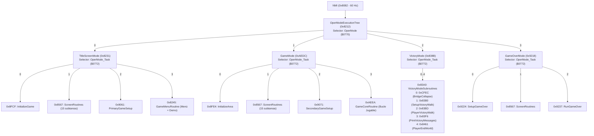

# Super Mario Bros. (NES) — Reporte de Fase 3: `JumpEngine` y Árbol de Modos de Juego

## 1. El Despachador Dinámico `JumpEngine` (`0x8E04..0x8E18`)

En **Super Mario Bros.**, casi todo el flujo de control de alto nivel (modos de juego, subtareas de pantalla, estados del jugador, decodificación de objetos de nivel e inteligencia artificial de enemigos) se implementa mediante llamadas `JSR $8E04` seguidas inmediatamente por una tabla de punteros de 16 bits incrustada en el flujo de código.

### Desensamblado exacto (`0x8E04..0x8E18`, file offset `+0x0E04..+0x0E18`)

```assembly
; =============================================================================
; JumpEngine (0x8E04) — Despachador de tablas de salto in-line
; Entrada: A = índice de la rutina en la tabla (0, 1, 2, ...)
; Uso en memoria Zero-Page:
;   $04..$05 = Dirección de retorno extraída de la pila (apunta a JSR+2)
;   $06..$07 = Dirección destino leída de la tabla (usada por JMP ($0006))
; =============================================================================
0x8E04 [file +0x0E04]  0A        ASL A           ; A = A * 2 (cada puntero ocupa 2 bytes)
0x8E05 [file +0x0E05]  A8        TAY             ; Y = offset en bytes dentro de la tabla
0x8E06 [file +0x0E06]  68        PLA             ; Extraer byte bajo de dirección de retorno (JSR+2)
0x8E07 [file +0x0E07]  85 04     STA $04         ; Guardar en $04
0x8E09 [file +0x0E09]  68        PLA             ; Extraer byte alto de dirección de retorno (JSR+2)
0x8E0A [file +0x0E0A]  85 05     STA $05         ; Guardar en $05
0x8E0C [file +0x0E0C]  C8        INY             ; Y = 2*A + 1 (primer byte tras el JSR $8E04)
0x8E0D [file +0x0E0D]  B1 04     LDA ($04),Y     ; Leer byte bajo del puntero destino
0x8E0F [file +0x0E0F]  85 06     STA $06         ; Guardar en $06
0x8E11 [file +0x0E11]  C8        INY             ; Y = 2*A + 2
0x8E12 [file +0x0E12]  B1 04     LDA ($04),Y     ; Leer byte alto del puntero destino
0x8E14 [file +0x0E14]  85 07     STA $07         ; Guardar en $07
0x8E16 [file +0x0E16]  6C 06 00  JMP ($0006)     ; Salto indirecto a la rutina seleccionada
```

> **Por qué es crítico en Ingeniería Inversa**: En el 6502, `JSR` empuja a la pila la dirección del último byte de la propia instrucción `JSR` (`JSR_addr + 2`) y no consume el retorno con `RTS`, sino con dos `PLA` seguidos de `JMP ($0006)`. Por ello, cualquier desensamblador estático convencional interpreta erróneamente los punteros posteriores a `JSR $8E04` como instrucciones de código basura y pierde todas las funciones destino si no se resuelven las tablas de `JumpEngine`.

---

## 2. Inventario Completo de las 18 Tablas `JumpEngine` en la ROM

Un escaneo exhaustivo del opcode `20 04 8E` (`JSR $8E04`) sobre los 32 KB de [smb_prg.bin](file:///c:/Antigravity_Projects/SuperMarioBros_REA/smb_prg.bin) revela exactamente **18 tablas de despacho** en todo el juego:

| # | Call Site (`JSR $8E04`) | Inicio Tabla | Entradas | Variable / Selector (`A`) | Subsistema / Función |
| :-: | :--- | :--- | :-: | :--- | :--- |
| 1 | `0x8215` | `0x8218` | **4** | `OperMode` (`$0770`) | `OperModeExecutionTree` (Raíz del juego: Title, Game, Victory, GameOver) |
| 2 | `0x8234` | `0x8237` | **4** | `OperMode_Task` (`$0772`) | `TitleScreenMode` (Tareas del modo pantalla de título / demo) |
| 3 | `0x83A3` | `0x83A6` | **5** | `OperMode_Task` (`$0772`) | `VictoryModeSubroutines` (Puente de Bowser, caída, caminar hacia Toad/Peach) |
| 4 | `0x856A` | `0x856D` | **15** | `ScreenRoutineTask` (`$073C`) | `ScreenRoutines` (Construcción gradual de pantallas, HUD, cortinilla y nivel) |
| 5 | `0x921B` | `0x921E` | **3** | `OperMode_Task` (`$0772`) | `GameOverMode` (Inicialización, dibujo y espera en pantalla Game Over) |
| 6 | `0x92C8` | `0x92CB` | **8** | `AreaType` (`$074E`) | `GetAreaDataAddrs` / Decodificador de metatile y estilo de escenario (Agua, Tierra, Subterráneo, Castillo) |
| 7 | `0x9664` | `0x9667` | **47** | Objeto de área decodificado | `DecodeAreaData` (Constructores de los 47 tipos de objetos geométricos del nivel: tuberías, bloques, escaleras, agujeros, castillos) |
| 8 | `0x9743` | `0x9746` | **3** | `TreeLedgeMetatile` (`$0733`) | `LargePlatformSubroutines` (Plataformas grandes de árboles, setas y cañones) |
| 9 | `0xAEDF` | `0xAEE2` | **4** | `OperMode_Task` (`$0772`) | `GameMode` (Tareas del modo de partida activa) |
| 10 | `0xB04C` | `0xB04F` | **13** | `GameEngineSubroutine` (`$0E`) | `GameRoutines` (Máquina de estados de Mario: control normal, tuberías, mástil de bandera, muerte, cambio de área) |
| 11 | `0xB34E` | `0xB351` | **4** | `AutoControlPlayer` / estado | Subestados de secuencia de entrada a tubería / castillo |
| 12 | `0xBDBD` | `0xBDC0` | **9** | Tipo de colisión / rebote | Procesador de bloques golpeados / rebotes e interacciones |
| 13 | `0xC27F` | `0xC282` | **55** | `Enemy_ID,X` (`$0016,X`) | `InitEnemyObject` / Despachador principal de inicialización de entidades y enemigos |
| 14 | `0xC7A8` | `0xC7AB` | **6** | `Enemy_ID - #$12` | Sub-despachador de generadores continuos (Lakitu, Cheep-Cheep, Bullet Bills) |
| 15 | `0xC88F` | `0xC892` | **34** | `Enemy_ID,X` (`$0016,X`) | `RunEnemyObjectsCore` (Ejecución por frame de IA y movimiento de enemigos estándar) |
| 16 | `0xC907` | `0xC90A` | **21** | Estado / tipo de enemigo | Manejador de movimientos/estados secundarios de enemigos y proyectiles |
| 17 | `0xC987` | `0xC98A` | **7** | `Enemy_ID - #$24` | `RunLargePlatform` (Plataformas móviles de polea, elevadores y puentes) |
| 18 | `0xD2E5` | `0xD2E8` | **5** | Estado de objeto especial | Manejador de objetos especiales / power-ups (`PowerUpObjHandler` / `VineObjectHandler`) |

---

## 3. Árbol de Ejecución Principal: `OperModeExecutionTree` (`0x8212`)

Invocado una vez por fotograma desde `NMI` (`0x8175: JSR $8212`) siempre que el juego no esté en pausa (`GamePauseStatus` bit 0 == 0):

```assembly
0x8212  AD 70 07  LDA $0770       ; Cargar OperMode ($0770)
0x8215  20 04 8E  JSR $8E04       ; JumpEngine
0x8218  31 82     .dw $8231       ; [0] TitleScreenMode (Modo Pantalla de Título / Demo)
0x821A  DC AE     .dw $AEDC       ; [1] GameMode        (Modo Partida Activa)
0x821C  8B 83     .dw $838B       ; [2] VictoryMode     (Modo Victoria / Castillo)
0x821E  18 92     .dw $9218       ; [3] GameOverMode    (Modo Game Over)
```



---

## 4. Desglose de los 4 Modos de `OperModeExecutionTree`

### 4.1. Modo 0 — `TitleScreenMode` (`0x8231`)

Controlado por `OperMode_Task` (`$0772`) mediante `JSR $8E04` en `0x8234`:

| `OperMode_Task` (`$0772`) | Dirección | Nombre de Función | Comportamiento Recuperado |
| :-: | :--- | :--- | :--- |
| `0` | `0x8FCF` | `InitializeGame` | Inicializa variables de partida, mundo/nivel `1-1` y avanza `OperMode_Task` a `1`. |
| `1` | `0x8567` | `ScreenRoutines` | Ejecuta paso a paso las 15 subtareas de preparación de pantalla (`ScreenRoutineTask` en `$073C`), incluyendo el volcado de los datos del logo de título desde CHR-ROM. |
| `2` | `0x9061` | `PrimaryGameSetup` | Configura los parámetros iniciales de escenario y música/silencio antes de entrar al bucle del menú. |
| `3` | `0x8245` | `GameMenuRoutine` | Lee los mandos (`$06FC \| $06FD`):<br/>• **`START` (`#$10` / `#$90`)**: Salta a `0x82D8` (`ChkContinue` -> inicia partida pasando `OperMode` (`$0770`) a `1`).<br/>• **`SELECT` (`#$20`)**: Alterna entre 1 y 2 jugadores (`NumberOfPlayers` en `$077A`, `EOR #$01`) y dibuja el cursor (`JSR $8325`).<br/>• **`B` (`#$40`) tras completar el juego (`$07FC != 0`)**: Incrementa `WorldNumber` (`$076B`, `0..7`) para elegir mundo inicial.<br/>• **Inactividad (`$07A2 == 0`)**: Ejecuta `DemoEngine` (`JSR $836B`) reproduciendo las entradas pregrabadas de Mario y el motor de juego (`JSR $AEEA`). |

---

### 4.2. Sub-despachador Compartido: `ScreenRoutines` (`0x8567`)

Tanto `TitleScreenMode`, `GameMode` como `GameOverMode` invocan `0x8567` cuando `OperMode_Task == 1` para construir la pantalla a través de varios fotogramas sin desbordar el tiempo de VBlank. Se indexa mediante `ScreenRoutineTask` (`$073C`):

| Índice (`$073C`) | Dirección | Nombre Recuperado | Descripción |
| :-: | :--- | :--- | :--- |
| `0` | `0x858B` | `InitScreen` | Inicializa buffers y apaga pantalla antes de redibujar. |
| `1` | `0x859B` | `SetupIntermediate` | Prepara pantalla intermedia (vidas de Mario / `WORLD X-Y`). |
| `2` | `0x8652` | `WriteTopStatusLine` | Escribe la línea superior del HUD (`MARIO`, `WORLD`, `TIME`). |
| `3` | `0x865A` | `WriteBottomStatusLine` | Escribe la segunda línea del HUD (puntuación, monedas, mundo actual). |
| `4` | `0x8693` | `DisplayTimeUp` | Muestra mensaje `TIME UP` si murió por tiempo agotado. |
| `5` | `0x889D` | `ResetSpritesAndScreenTimer1` | Oculta sprites y avanza tarea de pantalla. |
| `6` | `0x86A8` | `DisplayIntermediate` | Dibuja el icono de Mario y contador de vidas (`x 3`) o pantalla de `GAME OVER`. |
| `7` | `0x889D` | `ResetSpritesAndScreenTimer2` | Reinicio de temporizador tras pantalla intermedia. |
| `8` | `0x86E6` | `AreaParserTaskControl` | Renderiza las primeras columnas del nivel llamando al decodificador de áreas antes de encender el PPU. |
| `9` | `0x85BF` | `GetAreaPalette` | Carga la paleta de colores de fondo/sprites según `AreaType` (`$074E`). |
| `10` | `0x85E3` | `GetBackgroundColor` | Carga el color de cielo/fondo específico del nivel. |
| `11` | `0x8643` | `GetAlternatePalette1` | Carga paleta alternativa (p. ej. champiñones/castillos). |
| `12` | `0x86FF` | `DrawTitleScreen` | Transfiere el layout del logo de título desde CHR-ROM (`$1EC0`) a VRAM. |
| `13` | `0x8732` | `ClearBuffersDrawIcon` | Limpia buffers de trabajo y dibuja el cursor del menú principal. |
| `14` | `0x8749` | `WriteTopScore` | Formatea y pinta los dígitos del récord en la pantalla de título. |

---

### 4.3. Modo 1 — `GameMode` (`0xAEDC`) y `GameCoreRoutine` (`0xAEEA`)

Cuando `OperMode ($0770) == 1`, `0xAEDC` despacha según `OperMode_Task ($0772)`:

1. **Tarea `0` (`0x8FE4` — `InitializeArea`)**: Inicializa los punteros del área actual y resetea el scroll.
2. **Tarea `1` (`0x8567` — `ScreenRoutines`)**: Muestra la pantalla de vidas (`WORLD X-Y`) y pre-renderiza las primeras pantallas del nivel.
3. **Tarea `2` (`0x9071` — `SecondaryGameSetup`)**: Reactiva la detección de Sprite #0 (`$0722`), carga la música del nivel y avanza `OperMode_Task` a `3`.
4. **Tarea `3` (`0xAEEA` — `GameCoreRoutine`)**: **El bucle principal de partida activa en cada frame**:
   - **`0xAEEA..0xAEF2`**: Selecciona los controles del jugador activo (`CurrentPlayer` en `$0753`) y los copia en `$06FC`.
   - **`0xAEF3: JSR $B04A` (`GameRoutines`)**: Ejecuta la máquina de estados del jugador (Mario) indexada por `GameEngineSubroutine` (`$0E`, 13 estados posibles en la tabla `0xB04F`):
     - `[0] 0x9131` (`Entrance_GameTimerSetup`): Configuración inicial al aparecer Mario en el nivel.
     - `[1] 0xB1C7` (`Vine_AutoClimb`): Subida automática por planta trepadora.
     - `[2] 0xB206` (`SideExitPipeEntry`): Entrada lateral en tubería.
     - `[3] 0xB1E5` (`VerticalPipeEntry`): Descenso/ascenso por tubería vertical.
     - `[4] 0xB2A4` (`FlagpoleSlide`): Deslizamiento por el mástil de la bandera al final del nivel.
     - `[5] 0xB2CA` (`PlayerEndLevel`): Secuencia de caminar hacia el castillo y cuenta atrás de puntos por tiempo.
     - `[6] 0x91CD` (`PlayerLoseLife`): Pausa y transición tras perder una vida.
     - `[7] 0xB069` (`PlayerEntrance`): Animación de entrada inicial al nivel (caminar, caer del cielo o salir de tubería).
     - `[8] 0xB0E9` (`PlayerCtrlRoutine`): **Control normal del jugador en tiempo real** (lectura de D-Pad/A/B, salto, carrera, disparo de bolas de fuego, física de Mario).
     - `[9] 0xB233` (`PlayerChangeSize`): Animación de transformación (crecer con Super Champiñón o encoger al recibir daño).
     - `[10] 0xB245` (`PlayerInjuryBlink`): Estado transitorio de daño/encogimiento.
     - `[11] 0xB269` (`PlayerDeath`): Animación de salto de muerte de Mario.
     - `[12] 0xB27D` (`PlayerFireFlower`): Animación de cambio de paleta al obtener la Flor de Fuego.
   - **`0xAEFE: JSR $B624` (`ScrollHandler`)**: Calcula el desplazamiento de cámara (`HorizontalScroll`) según la velocidad y posición de Mario y dispara la decodificación de nuevas columnas del nivel.
   - **`0xAF01..0xAF0F` (Bucle de Entidades `X = 0..5`)**: Itera por los 6 slots de objetos/enemigos (`ObjectOffset` en `$08 = 0..5`), llamando en cada iteración a:
     - `JSR $C047` (`EnemiesAndLoopsCore`: ejecuta la IA/física del enemigo vía `0xC88F` y sus colisiones)
     - `JSR $84C3` (`FloateyNumbersRoutine`: gestiona los puntos flotantes `100`, `200`, `1UP` asociados a cada slot).
   - **`0xAF10..0xAF35` (Actualización de Objetos Auxiliares y Renderizado a OAM)**:
     - `JSR $F180` (`GetPlayerOffscreenBits`)
     - `JSR $F12A` (`RelativePlayerPosition`)
     - `JSR $EEE9` (`PlayerGfxHandler`: dibuja los metasprites de Mario en `$0200`)
     - `JSR $BED4` (`BlockObjMT_Updater`: actualiza bloques golpeados en VRAM)
     - `JSR $BE70` x2 (`BlockObjectsCore`: física de bloques que rebotan, para slots `X=1` y `X=0`)
     - `JSR $BB96` (`MiscObjectsCore`: martillos, monedas saltarinas, etc.)
     - `JSR $B9BC` (`ProcessWhirlpools`: remolinos en fases acuáticas)
     - `JSR $B7B8` (`FlagpoleRoutine`: objeto de la bandera del final del nivel)
     - `JSR $B855` (`ColorRotation`: rotación de paleta de las monedas/bloques de interrogación y Mario Estrella).

---

### 4.4. Modo 2 — `VictoryMode` (`0x838B`)

Se activa cuando Mario toca el hacha al final de un castillo (`X-4`). En cada fotograma:
1. Llama a `JSR $83A0` (`VictoryModeSubroutines`), que despacha según `OperMode_Task ($0772)` mediante `JSR $8E04` (`0x83A3`):
   - **`[0] 0xCFEC` (`BridgeCollapse`)**: Destruye cadena y bloques del puente de Bowser uno a uno y hace caer a Bowser al vacío.
   - **`[1] 0x83B0` (`SetupVictoryWalk`)**: Configura el límite de scroll hacia la sala del retenido (Toad o Peach) y dispara la fanfarria de victoria (`STA $FC`).
   - **`[2] 0x83BD` (`PlayerVictoryWalk`)**: Hace caminar automáticamente a Mario (`JSR $B0E6`) y desplaza la cámara hasta encuadrar a Toad/Peach.
   - **`[3] 0x83F6` (`PrintVictoryMessages`)**: Muestra progresivamente `"THANK YOU MARIO!"` y `"BUT OUR PRINCESS IS IN ANOTHER CASTLE!"` (o el mensaje final de Peach en el Mundo 8-4).
   - **`[4] 0x8461` (`PlayerEndWorld`)**: Espera a que termine la música, suma un mundo (`WorldNumber++`) y transiciona de vuelta a `GameMode` (o activa el modo New Quest con botón `B` tras completar el Mundo 8-4).
2. Actualiza enemigos/objetos restantes (`JSR $C047`) y redibuja a Mario (`JSR $F12A` -> `JMP $EEE9`).

---

### 4.5. Modo 3 — `GameOverMode` (`0x9218`)

Despacha según `OperMode_Task ($0772)` mediante `JSR $8E04` en `0x921B`:
- **`[0] 0x9224` (`SetupGameOver`)**: Resetea `ScreenRoutineTask ($073C) = 0`, desactiva Sprite #0 (`$0722 = 0`), dispara la música de Game Over (`LDA #$02 / STA $FC`), apaga la pantalla (`INC $0774`) e incrementa `OperMode_Task ($0772)` a `1`.
- **`[1] 0x8567` (`ScreenRoutines`)**: Dibuja el HUD y el texto central `"GAME OVER"` en la nametable.
- **`[2] 0x9237` (`RunGameOver`)**: Reactiva la pantalla (`$0774 = 0`), espera a que el jugador pulse `START` (`$06FC & #$10`) o a que expire el temporizador `ScreenTimer` (`$07A0`), guarda el mundo en `ContinueWorld` (`$075F -> $07FD`) y reinicia `OperMode ($0770) = 0` para volver a `TitleScreenMode`.
